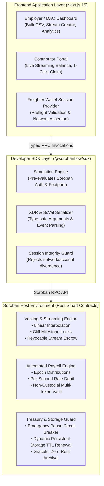

# 🌊 SorobanFlow
> **Turnkey Automated Payroll, Continuous Streaming & Session-Guarded Vesting Protocol for Stellar / Soroban**

[](https://github.com/Ranjeet2063/sorobanflow/actions/workflows/ci.yml)
[](https://github.com/Ranjeet2063/sorobanflow/releases)
[](https://opensource.org/licenses/MIT)
[](https://soroban.stellar.org)
[](https://www.rust-lang.org)

---

## 📌 Overview
**SorobanFlow** is a decentralized, non-custodial streaming and payroll infrastructure natively engineered for the **Stellar / Soroban** network. It empowers decentralized organizations, startups, and cross-border teams to execute continuous token streaming, milestone payouts, and cliff vesting in **USDC/EURC** with sub-cent transaction costs (< $0.0001) and deterministic 4–5 second finality.

---

## 🌟 Key Features
* **Continuous Real-Time Streaming**: Stream salaries block-by-block using linear time-decay interpolation.
* **Epoch-Based Automated Payroll**: Schedule recurring batch distributions without manual approval bottlenecks.
* **Cliff & Vesting Milestone Locks**: Lock team/advisor tokens with enforceable cliff periods and linear unlock curves.
* **Freighter Preflight Session Guards**: Built-in client validation catching network/account mismatches before submitting Soroban transactions.
* **Autonomous Storage TTL Renewal**: Automatic persistent storage lifetime extension on contract invocation, preventing ledger expiration.
* **Non-Custodial Multi-Token Support**: Native support for Stellar USDC, EURC, and custom Soroban SAC tokens.
* **Developer SDK**: Lightweight TypeScript SDK (`@sorobanflow/sdk`) with Next.js/React hooks.

---

## 🏗️ Architecture



---

## 🧪 Testing & Verification

```bash
# Build contracts
cargo build --target wasm32-unknown-unknown --release

# Run unit and integration tests
cargo test
```

---

## 📄 License
Released under the [MIT License](LICENSE).
